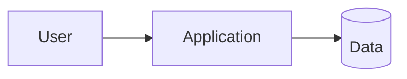

Feature: <ID>
Stage: architect
Author-agent: architect
Date: <YYYY-MM-DD>
Approved-by:
<!-- Gate: the approver fills in the line above as `Approved-by: <name> <YYYY-MM-DD>`. Leave it empty when there is no gate. -->

# System architecture

## Context
<what the system does; users; external systems>

## Components
| Component | Responsibility | Technology | Owner |
|---|---|---|---|

## Main data flows
1. <...>

## NFR → solution
| NFR | Solution | ADR |
|---|---|---|

## Boundaries and dependencies
<which module calls which; one direction only>

## Risks
- <...>
