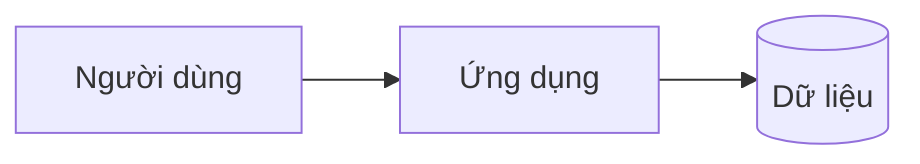

Feature: <ID>
Stage: architect
Author-agent: architect
Date: <YYYY-MM-DD>
Approved-by:
<!-- Cổng: người duyệt điền dòng trên `Approved-by: <tên> <YYYY-MM-DD>`. Không có cổng thì để trống. -->

# Kiến trúc hệ thống

## Bối cảnh
<hệ thống làm gì; người dùng; hệ thống ngoài>

## Thành phần
| Thành phần | Trách nhiệm | Công nghệ | Chủ sở hữu |
|---|---|---|---|

## Luồng dữ liệu chính
1. <...>

## NFR → giải pháp
| NFR | Giải pháp | ADR |
|---|---|---|

## Ranh giới và phụ thuộc
<module nào gọi module nào; một chiều>

## Rủi ro
- <...>
